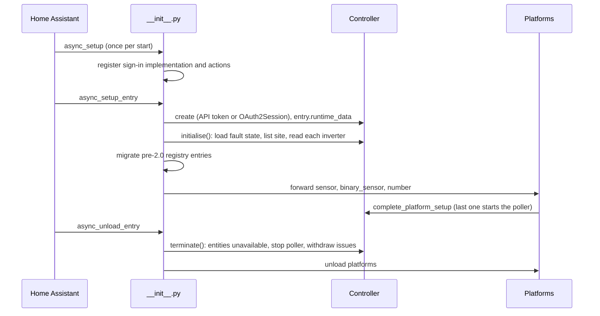
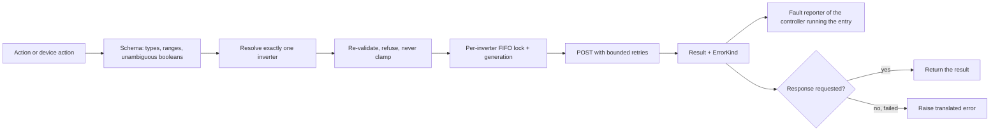

# How Eleven Energy Plus works

This is the developer's map of the integration: what each module does, how
data and commands flow, what can run at the same time, and the invariants
the tests hold the code to. For how to work on it (setup, tests, gates,
releasing) see [CONTRIBUTING.md](../CONTRIBUTING.md); for what users see, the
[README](../README.md).

The integration controls a home battery inverter. A wrong value shown as
current, or a command sent to the wrong machine or silently dropped, has
real consequences, so the design favours refusing and reporting over
guessing, at every step.

## Modules

Everything lives in `custom_components/eleven_energy_plus/`.

| Module | Responsibility |
| --- | --- |
| `__init__.py` | Lifecycle: `async_setup` (sign-in implementation, actions), `async_setup_entry` / `async_unload_entry` / `async_remove_entry`, device deletion, the options update listener. |
| `controller.py` | `Controller`, the only code that talks to the Eleven Energy API: credential, discovery, the poller, availability accounting, work-mode commands (validation, target resolution, ordering, retries), rate limiting, credential recovery. |
| `hybrid_inverter.py` | `HybridInverter`, one per inverter: which entities exist (curated, model-driven, auto-discovered), the payload walker that turns a reading into entity values, availability and offline state, the counter guard; the sensor and binary sensor entity classes. |
| `notifications.py` | `FaultReporter`: repair issues and persistent notifications for lasting faults, the persisted optimiser timer. |
| `services.py` | The seven `set_work_mode_*` actions: schemas, handler, mapping each `ErrorKind` to an exception and translated message. |
| `device_action.py` | Device actions that delegate to the actions above, with the same field validators. |
| `config_flow.py` | Setup, reconfigure, reauthentication (token or sign-in) and the options flow; every credential is probed against the API before it is stored. |
| `oauth.py` | The public PKCE OAuth client, with one verifier per flow. |
| `number.py` | The per-inverter Update Interval entity (writes the entry-wide option). |
| `sensor.py`, `binary_sensor.py` | Platform shims: hand the inverters' entities to Home Assistant and register for ones found later. |
| `diagnostics.py` | The redacted diagnostics download. |
| `migration.py` | Moves pre-2.0 positional registry entries onto the curated entities; removes ones for absent hardware. |
| `parsing.py` | Strict parsers shared by everything: finite floats, whole numbers, unambiguous booleans, `Retry-After`. |
| `const.py` | Every limit and threshold, with the reason for its value; `ErrorKind`. |
| `translations/en.json`, `services.yaml`, `manifest.json` | UI strings, action definitions, metadata. |

## Lifecycle

* **Setup.** `async_setup_entry` builds the `Controller`, stores it on
  `entry.runtime_data` and calls `initialise()`, which loads the fault
  reporter's state, lists the site and reads every hybrid inverter once. A
  rejected credential raises `ConfigEntryAuthFailed` (Home Assistant starts
  reauthentication); an unreachable API, a malformed listing or a site with
  no hybrid inverter raises `ConfigEntryNotReady` (Home Assistant retries).
  Any exception after the controller exists terminates it, so a retry starts
  clean. The poller starts only when every platform has registered its
  add-entities callback, so entities found by the first poll reach every
  platform.
* **Options.** The update listener asks the controller what changed. A new
  poll interval is applied live (the poller is woken); a new device label
  needs a reload, because device info is registered at platform setup.
  Credential changes come from the flows, which schedule their own reload,
  and an OAuth token refresh changes nothing.
* **Unload and reload.** `terminate()` runs *before* the platforms unload:
  every entity goes unavailable, the shutdown event is set (which also ends
  any command's retry backoff), the poller is cancelled and given 5 seconds
  to settle, and every repair issue and notification is withdrawn. A failed
  unload therefore still leaves nothing stale on show. Home Assistant keeps
  `runtime_data` after a failed unload or failed setup, so code that finds a
  controller checks `controller.terminated` before treating it as live.
* **Removal.** `async_remove_entry` deletes the stored optimiser timers and
  any issues left behind. Deleting a device is allowed only for an inverter
  that has left the site listing (or while nothing is running the entry),
  since a listed one would come straight back.

## Polling

One background task per entry (`Controller.start_poller`). It first reads
any inverter discovery could not read, then loops: wait for the poll
interval, or until woken by an options change or a successful command, then
run one cycle.

1. **Credential check.** While the credential is rejected nothing is polled.
   A rejection by HTTP status is re-tested every 10 minutes
   (`AUTH_RECOVERY_SECONDS`); a refused sign-in refresh is definitive.
2. **Site listing** (`poll_site`). New hybrid inverters are discovered in
   device-id order (read once, then their entities are built; an inverter
   that cannot be read, or is found while polling is deferred, is built from
   its listing and completes its hardware entities from its first reading).
   A new inverter whose name another already has is numbered (`ordinal`,
   `device_card_name`). An inverter missing from 2 consecutive listings
   (`MISSING_AFTER_SITE_POLLS`) is marked missing: its entities go
   unavailable and a repair is raised. When it is listed again it stays
   unavailable until a fresh reading arrives.
3. **Device readings** (`poll_devices`), one inverter at a time. A failure
   is counted against that inverter only; after 3 in a row
   (`UNAVAILABLE_AFTER_FAILED_POLLS`) its entities go unavailable. A reading
   that fails to process counts as a failure. A rejected credential stops
   the cycle and makes every inverter unavailable at once. HTTP 429 also
   stops the cycle and defers the next one by its `Retry-After` (seconds or
   an HTTP date, at most 5 minutes; 60 seconds when absent).
4. **Housekeeping.** Whether any request got an answer feeds the
   "cloud unreachable" timer; optimiser timers are checked.

Requests use a 30-second total timeout (10 s to connect). Device ids from
the listing are percent-encoded as a single path segment (`device_path`), so
no id can address another device, and ids of `.` or `..` are ignored. A
reading whose `deviceId` names a different device than the one requested is
refused as an API error.

## Values

`HybridInverter.update()` walks a reading. What an entity shows, in order:

1. **unavailable** when its inverter is: too many failed polls, a rejected
   credential, missing from the listing, or the integration stopped.
   Telemetry is also unavailable while the inverter reports `online: false`;
   the entities that explain an outage (Online, Status, Firmware Version, API
   Connection, the ratings) stay available.
2. **unknown** when the latest reading has no usable value: the field is
   null, absent (each reading clears every path it did not contain), or not
   a valid value of its kind (a non-finite number, an ambiguous boolean,
   text longer than the 255 characters of a state).
3. Otherwise the value. A value is never carried over from an older reading.

`total_increasing` counters go through `TotalIncreasingGuard`: Home Assistant
books a drop of 10 % or more as a meter reset, so a lower reading is shown
as unknown until the next reading confirms it. A drop of at least 10 % is a
reset only when the reading straight after it is such a drop too; any other
lower reading is a correction and keeps the previous value, so a held
correction or a small dip can never confirm a later one-off drop. Negatives
are never shown. Counters are `RestoreSensor`s, and after a restart the
first reading is judged against the restored value.

Lists (`pv.mppts`, `battery.batteries`) are keyed by each item's own `index`;
items with a missing, repeated or out-of-range index are ignored and
reported once. The walker handles each leaf on its own, so one malformed
field cannot spoil the rest; lists are capped at 32 items, nesting at 12
levels, and auto-discovery at 200 entities per inverter.

## Commands

* **Validation.** The action schema rejects out-of-range values, NaN and
  infinity, booleans where numbers are expected, ambiguous booleans, unknown
  and missing fields. The controller re-checks everything for direct
  callers, and refuses rather than clamps.
* **Targeting.** `device_id`, `entity_id` and `area_id` must resolve to
  exactly one inverter; with no target only a single-inverter site is
  accepted.
* **Ordering.** Each inverter has an `asyncio.Lock` (fair, first in first
  out) and a generation counter. A command takes a generation when it is
  issued; while it waits for the lock or between retries it checks whether a
  newer one was issued, and if so stops as `superseded`. The newest command
  always wins, and two commands are never in flight to one inverter.
* **Retries.** Only network errors, timeouts, 408, 429 and 5xx are retried:
  at most 5 attempts, waits of 1, 2, 4 and 8 seconds, a `Retry-After`
  lengthening one wait to at most 30 seconds. Setting a work mode is
  idempotent, so repeating a request the API may have applied is safe.
  Shutdown aborts the backoff.
* **Outcome.** `set_work_mode` never raises: even an internal error is
  caught, logged with its traceback and returned as `internal_error`. Every
  result carries an `ErrorKind`, which the action handler maps one-to-one to
  an exception class and translated message. A success wakes the poller.

## Fault reporting

`FaultReporter` raises a repair issue for as long as a fault lasts, with a
persistent notification the first time it appears:

| Issue | Raised | Cleared |
| --- | --- | --- |
| `cloud_unreachable` | no request has been answered for 15 minutes | any answer (a rejected credential or a 429 counts as one) |
| `inverter_offline_<id>` | `online: false` for 15 minutes | an online reading; the timer restarts while the inverter is missing |
| `inverter_missing_<id>` | missing from 2 listings | listed again, or the device is deleted |
| `work_mode_failed_<id>` | a command failed for an API, credential or internal reason | the next success |
| `optimiser_off_<id>` | a work mode other than Reset was set 24 hours ago | Reset Work Mode |

A rejected credential adds a notification to Home Assistant's own
reauthentication prompt. Durations use the monotonic clock, so changing the
time of day moves nothing; the optimiser timer must survive a restart, so it
is stored (`helpers.storage.Store`, key `eleven_energy_plus.<entry_id>`) in
UTC and restarts if the clock moves back past it.

A reporter belongs to one controller. Once that controller stops, the
reporter is closed: it shows nothing and stores nothing, because nothing
would be left to clear it and the stored timers belong to the next
reporter. A command that finishes after its controller stopped reports to
the controller now running the entry, if there is one.

## Credentials

* **API token:** sent as a Bearer token; entered in the token step, and
  validated against the API before it is stored.
* **Account sign-in:** OAuth2 authorization code with PKCE, Eleven Energy's
  public client id and no secret, redirected through `my.home-assistant.io`.
  Home Assistant's `OAuth2Session` refreshes the access token (under its own
  lock); a refresh never reloads the entry. Each flow gets its own PKCE
  verifier when its authorization link is built, and the code exchange uses
  the verifier of the flow named in the returned `state`, so two sign-ins
  open at once cannot spoil each other.
* Every credential, from every entry point, is probed: a rejected or
  unreachable credential, a site without hybrid inverters, or (when
  replacing a credential) a different site is refused.

## Concurrency model

Home Assistant runs the integration on one event loop. Two pieces of code
interleave only at an `await`, so the questions are always "what can happen
while this is waiting on the network?" and "what if this finishes after
that?". The tasks that can be in flight at once are:

* the poller (one per entry), and discovery within it;
* any number of work-mode commands, from actions, device actions and
  automations;
* config, reconfigure, reauthentication and options flows;
* the user deleting a device, reloading, unloading or removing the entry;
* Home Assistant refreshing the OAuth token.

Invariants, each pinned by tests (ledger ids in
[`tests/DEFECTS.md`](../tests/DEFECTS.md)):

| Invariant | Pinned by |
| --- | --- |
| Only the poll and discovery paths feed readings to an inverter; a command only wakes the poller. | By construction (`HybridInverter.update` has no other caller); FC-CMD-06 |
| An entity never shows a value older than the latest reading, including after an inverter returns to the listing. | D11, D36 |
| A reading is applied only to the inverter it names. | D45 |
| An energy counter reports a reset only when two readings in a row confirm it. | D13, D33, D44 |
| No two inverters share a name. | D49 |
| Commands to one inverter run one at a time, and the newest wins. | FC-CMD-03, FC-CMD-04 |
| A device id only ever addresses its own device. | D42 |
| A stopped controller never revives an entity, and nothing it reports afterwards is shown or stored; a late command outcome goes to the controller running the entry. | D10, D37, D39, D41 |
| A deleted inverter gets no reading stored and no issue raised. | D38 |
| An outage timer only counts time in which its condition was observed. | D40 |
| Two sign-ins in progress never share a PKCE verifier. | D35 |
| Each failure has exactly one `ErrorKind`, exception and message. | D08, D09, D16 |

The race tests live in `tests/test_lifecycle_races.py`: they hold a request
open with an `asyncio.Event`, perform the overlapping step, then release
it.

## Compatibility

The minimum is Home Assistant 2026.3 (`hacs.json`; custom integrations serve
their own brand images from then on). The suite runs on 2026.3.4, 2026.10.4
and the newest release. Rules that keep it working across versions:

* Only public Home Assistant imports (checked by
  `test_home_assistant_import_is_public` on every version).
* `async_entity_id_changed` is defined on every entity, opting in to
  in-place entity id changes on 2026.11; older versions never call it.
* On 2026.9 and newer, voluptuous is aliased to probatio at runtime, so
  schemas handed to Home Assistant are typed `Any`.
* `DeviceInfo` is built by keyword; the percent unit is the plain `"%"`.

## Known limitations

These were reviewed and deliberately left as they are:

* **Unique ids** are `<device id>_<field>`, as before 2.0. Ids for two
  inverters could only collide if one inverter's id plus a field name
  spelled another's, which Eleven Energy's opaque ids rule out in practice;
  changing the scheme would cost every user their entity history.
* **The cloud is trusted** for what it reports. Readings are validated for
  shape and range, but a plausible wrong value from the API is shown.
* **One entry per instance** (`single_config_entry`). Every inverter on the
  site shares the entry's poll interval, so each inverter's Update Interval
  entity sets the same option.
* **A restart drops a command in flight.** Its caller sees the action fail
  (the call is cancelled); the API may or may not have applied it, and the
  next poll shows which.
* **An unusable device id** (`.` or `..`) is warned about once per Home
  Assistant run, not once per entry.
* **A timed-out command has an unknown outcome.** If a request times out,
  the cloud may still apply it, even after a newer command that succeeded.
  The newest command wins within the integration; the Work Mode sensor
  shows what is actually in effect.
* **The optimiser reminder only knows about Home Assistant's commands.** A
  Reset done in the Eleven Energy app does not stop it; the repair can be
  ignored from Settings > Repairs.
* **A label learnt late.** An inverter that could not be read when it was
  found, and whose listing has no `model` block, gets its hardware entities
  from its first reading but keeps the listing's name until the next start.
* **The offline timer keeps counting through failed polls and a rejected
  credential** (it restarts only after the inverter has been missing from
  the listing). Those periods raise their own repairs.
* **Commands to an inverter missing from the listing are still sent.** The
  cloud decides whether it still accepts them; a refusal is reported as
  usual.
